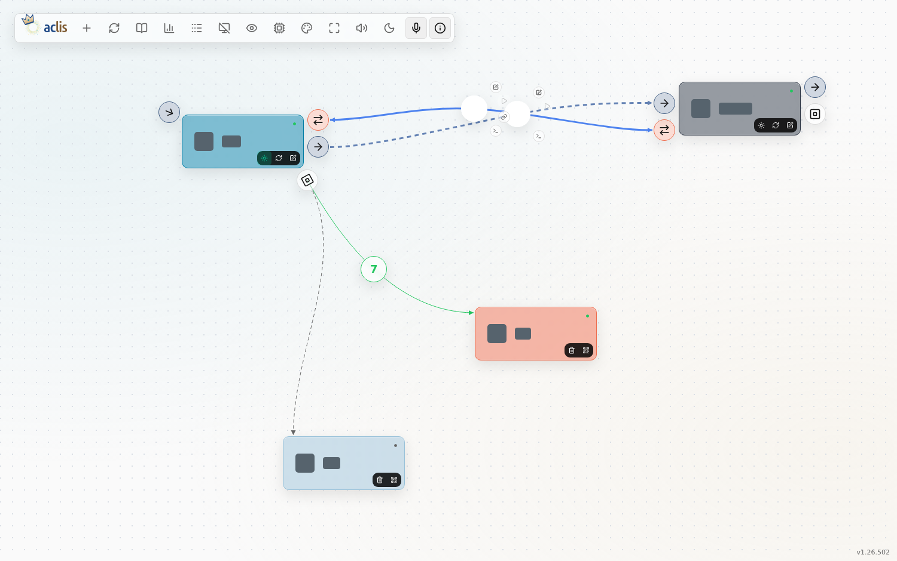
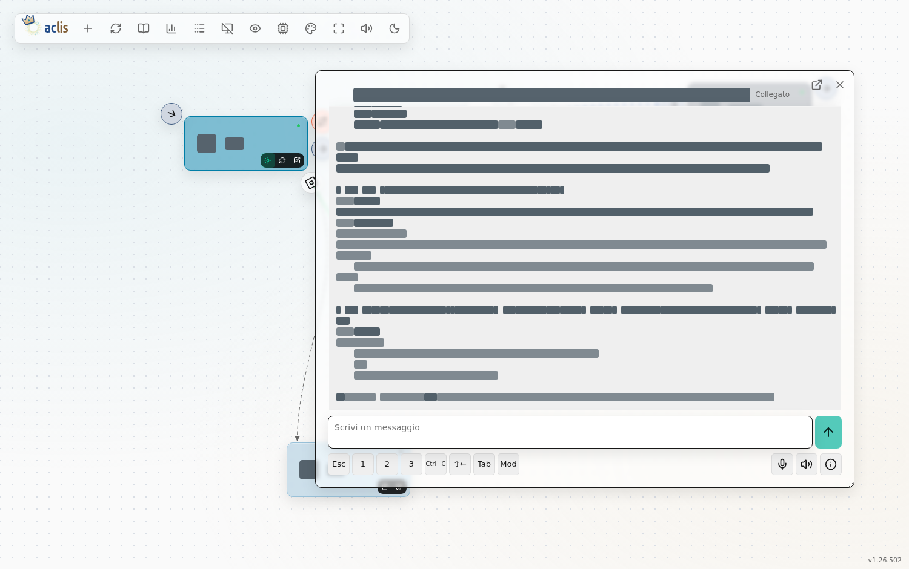
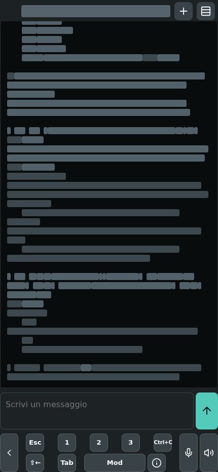

# Oaclis

**Chat, console e progetti su più dispositivi, da un'unica interfaccia.**

Abbiamo realizzato Oaclis come applicazione Rust con interfaccia desktop nel browser e accesso mobile tramite PWA. Riunisce chat Codex e conversazioni con modelli locali llama.cpp, collegamenti fra computer, trasferimento e sincronizzazione dei progetti, dettatura, lettura vocale e avanzamento dei tool.

Il nucleo Rust esegue le operazioni sui dispositivi collegati. SSH e rsync trasportano chat e file fra computer; la PWA comunica con Oaclis attraverso il relay PHP. Git distribuisce il programma e la documentazione.

La [guida operativa](docs/USO.md) descrive i passaggi per usare le funzioni realizzate, sul desktop e nella PWA.

Le immagini sono catture dell’interfaccia reale. Nomi, identificativi, riferimenti e contenuti delle conversazioni sono oscurati prima della cattura.

## Cosa abbiamo realizzato

| Area | Cosa offre |
| --- | --- |
| Dispositivi | Rilevamento in LAN, abbinamento approvato, mappa interattiva e stato dei collegamenti. |
| Chat | Catalogo, ricerca, ordinamento alfabetico, numerazione condivisa desktop/mobile, creazione e ripresa di chat Codex e llama.cpp. |
| Console | Più console aperte, finestre interne o separate, geometria persistente e comandi rapidi. |
| Trasferimenti | Copia e sincronizzazione di chat, percorsi e componenti dell'ambiente, con direzione e avanzamento visibili. |
| Mobile | PWA con passkey, chat autorizzate, console singola o doppia e controlli condivisi con il desktop. |
| Voce | Dettatura, comandi vocali, lettura delle risposte e conferme sonore. |
| Statistiche | Avanzamento dei tool associati a ogni chat e pannello aggregato. |
| Skill | Elenco delle skill, stato di abilitazione, verifica degli aggiornamenti e aggiornamento automatico facoltativo. |
| Gestione | Impostazioni dei motori AI, energia, riavvio e aggiornamento dei dispositivi, accesso a RustDesk quando disponibile. |

## Dispositivi e mappa

Ogni computer conserva un'identità stabile. La mappa mostra dispositivi, chat condivise e collegamenti distinti per sincronizzazione, invio, ricezione e console remota. Dispositivi e icone si possono spostare; spostare un oggetto modifica il layout e non avvia un trasferimento.

L'abbinamento richiede l'approvazione dei dispositivi coinvolti. Il collegamento SSH viene predisposto con chiavi dedicate e un comando vincolato a Oaclis. La semplice presenza nella rete non autorizza l'accesso.

Nomi, colori, icone, posizioni e impostazioni dei collegamenti vengono condivisi fra i computer abbinati. Credenziali e chiavi private restano separate. Le modifiche salvate offline vengono riallineate quando i dispositivi tornano a comunicare.

La mappa indica direzione e attività delle comunicazioni. Per le chat accessibili dal telefono, le animazioni identificano la destinazione e usano il colore della chat; quando lo spazio non basta, le chat vengono raccolte in un badge numerico.



## Chat e console

Oaclis riunisce il catalogo Codex dell’utente configurato e le conversazioni llama.cpp. Ogni chat si riprende sul dispositivo che la ospita. Le liste sono ordinate e i numeri delle chat restano coerenti fra desktop e PWA.

Dalla creazione di una chat si scelgono nome, motore disponibile, modello e cartella di lavoro. Colori, icona e autorizzazioni della console sono configurabili. La cartella di lavoro è quella del progetto. Codex conserva i propri archivi; Oaclis gestisce separatamente lo storico delle conversazioni llama.cpp.

Sul desktop si possono aprire più console contemporaneamente, portarle in primo piano, ridimensionarle, affiancarle o staccarle in finestre del browser. Posizione, dimensioni e modalità di apertura vengono ricordate. Il bordo evidenzia la console effettivamente in focus.

La console supporta testo e immagini, con selezione dei file, trascinamento e incolla dagli appunti dove il browser lo consente. Le risposte mantengono la formattazione del terminale e i collegamenti utilizzabili; lo scorrimento permette di leggere messaggi precedenti senza essere riportati continuamente in fondo.

I comandi rapidi condivisi sono:

| Pulsante | Azione |
| --- | --- |
| Esc | Invia Escape alla console. |
| 1 · 2 · 3 | Risponde alle scelte numerate del programma. |
| Ctrl+C | Termina la sessione selezionata e chiude le relative viste. |
| ⇧← | Invia Shift + freccia sinistra per rispondere alle domande in attesa di Codex. |
| Ctrl+T | Mostra o chiude il transcript di Codex. |
| Mod | Invia `/model` e Invio per aprire la selezione del modello in Codex. |
| ⓘ | Apre guida e impostazioni dei comandi vocali. |

Chiudere una finestra e terminare la sessione sono operazioni distinte: la chiusura della vista consente di riaprire la console; Ctrl+C richiede l'arresto della sessione.



## Copia e sincronizzazione

Ogni collegamento può includere separatamente **Chat**, **Percorsi** e **App**:

- **Chat:** archivio della conversazione e dati necessari alla sua ripresa.
- **Percorsi:** file e cartelle associati al progetto, con corrispondenze fra percorsi sui dispositivi ed esclusioni.
- **App:** inventario e componenti dell'ambiente supportati, incluse definizioni e file di skill/plugin e installazioni previste dal relativo modulo.

Analisi, confronto ed esecuzione sono passaggi distinti. I risultati delle analisi completate restano salvati; ricevere impostazioni o aprire un pannello non equivale a trasferire i contenuti.

Il confronto individua le differenze e propone il verso del trasferimento. Usa la cronologia e l'attività della chat, insieme alle prove dei contenuti dei percorsi. Quando non può determinare una direzione attendibile, segnala un conflitto.

**Il trasferimento richiede Play**, anche la prima volta:

- Un collegamento monodirezionale conclude il proprio lavoro dopo il trasferimento riuscito.
- Un collegamento bidirezionale continua a confrontare le copie; le differenze si trasferiscono con Play.
- Se un dispositivo è offline, il collegamento resta in attesa.

L’installazione delle App gestisce Node.js/npm e le dipendenze Node con un lockfile coerente, verifica le versioni presenti e registra l’esito sulla destinazione.

I file viaggiano tramite rsync su SSH, con avanzamento reale. Il trasferimento dei percorsi non usa `--delete`. La copia all'origine viene conservata; eliminare una chat è un'azione separata e confermata, distinta dalla rimozione di un collegamento.

I dispositivi abbinati possono continuare a scambiarsi le impostazioni ed eseguire i collegamenti configurati quando il master è spento. Questo non rende disponibile la console mobile di un computer spento.

## PWA e accesso remoto

La PWA consente di utilizzare dal telefono le chat concesse dal master, senza installare Oaclis sul telefono. Offre elenco delle chat, indicatori delle sessioni aperte, percentuali dei tool e console singola o due console sovrapposte con un'unica barra dei controlli, indirizzata alla console selezionata.

L'accesso viene predisposto dal master tramite invito e abbinamento. Sul dispositivo riconosciuto e autorizzato la richiesta di passkey parte automaticamente quando serve autenticarsi; un accesso non riconosciuto alla pagina ordinaria non riceve l'interfaccia dell'app. Il percorso di invito permette il primo abbinamento.

Il master decide quali chat concedere e può revocare l'accesso. La passkey protegge l'accesso web; una chiave del telefono firma le richieste, che il master verifica rispetto ai permessi locali. Il relay non può concedersi autonomamente accesso alle chat.

Chat e risposte della console non vengono conservate nella cache del service worker. La PWA è un client autonomo: gestisce la propria interfaccia e comunica con Oaclis tramite il relay. L’esecuzione delle chat resta sul computer associato.

Configurazione e dettagli del relay: [relay/README.md](relay/README.md).



## Dettatura e lettura vocale

Desktop e PWA usano lo stesso motore vocale e gli stessi comandi, disponibili in italiano e inglese. Il microfono serve alla dettatura e ai comandi; il pulsante voce controlla la lettura delle risposte.

Fra i comandi disponibili ci sono invio, cambio chat per nome o numero, pausa e ripresa della dettatura. È disponibile anche l’invio automatico dopo il tempo di attesa scelto nelle impostazioni. La guida ⓘ mostra le frasi e le impostazioni disponibili. I comandi vengono interpretati secondo il contesto, evitando di eseguire una parola di comando semplicemente perché compare dentro una frase dettata.

Dopo l'invio la scrittura può restare in pausa mantenendo l'ascolto dei comandi. «Avvia» riabilita la dettatura. Il riconoscimento e la riproduzione vocale condividono un workflow che distingue dettatura, pausa e lettura delle risposte.

Per usare la voce è richiesto **Google Chrome**. Il riconoscimento usa `SpeechRecognition`/`webkitSpeechRecognition`; la lettura usa le voci esposte da Chrome e dal sistema.

## Avanzamento dei tool

L’endpoint delle statistiche è incluso di default con Oaclis e condiviso dalle chat, senza installazioni aggiuntive. Script di traduzione, calcolo o elaborazione possono pubblicare uno stato minimale, indipendente dal motore AI. Ogni tool invia l'ID della chat, un proprio ID stabile, un testo e una percentuale:

```http
POST http://127.0.0.1:23232/api/jobs/status
Content-Type: application/json
```

```json
{
  "chat_id": "ID-REALE-DELLA-CHAT",
  "id": "elaborazione-dati",
  "text": "Fase 2: 125 elementi completati su 250",
  "progress": 50
}
```

La percentuale compare nella barra della chat; un clic o tap apre il dettaglio per cinque secondi. Il pannello **Statistiche** raccoglie una riga per tool, anche dai dispositivi abbinati, e può aprirsi in una finestra separata.

Al 100% l'indicatore lampeggia, viene emessa una sola notifica sonora e la voce viene poi nascosta. Il tool riceve `stop: true` e deve interrompere gli aggiornamenti di quel lavoro concluso.

Inviare `{}` allo stesso endpoint restituisce il contratto di integrazione. L'endpoint è locale al dispositivo che esegue Oaclis; non va pubblicato su Internet. Oaclis visualizza l'avanzamento ricevuto, senza stimarlo né comandare il calcolo.

Istruzioni da fornire alle chat che integrano i tool: [TOOL-INTEGRATION.md](docs/TOOL-INTEGRATION.md). Dettagli: [stato dei tool](docs/JOBS.md).

## Skill e aggiornamenti

Il pannello **Skill** raccoglie le skill rilevate sui dispositivi, indicando abilitazione e stato degli aggiornamenti. La verifica avviene in background all'avvio. Quando la fonte non consente di verificare una versione, lo stato resta non determinato.

L'opzione **Aggiorna automaticamente** abilita l'aggiornamento dei plugin gestiti e supportati. È facoltativa: la verifica avviene comunque. L'interfaccia segnala quando un aggiornamento è disponibile, in corso o non riuscito.

L'aggiornamento di Oaclis sui computer è separato: si avvia esplicitamente dal dispositivo interessato nella mappa. Il confronto usa l'impronta dei sorgenti oltre alla versione visualizzata; configurazioni e chat vengono conservate.

## Motori AI

Il pannello **Motori AI** centralizza scelta del motore, modello predefinito e configurazione delle credenziali. Viene proposto anche su un'installazione vuota.

| Motore | Stato |
| --- | --- |
| ChatGPT · Codex | Operativo per creazione, ripresa e gestione delle chat tramite Codex installato. |
| llama.cpp | Chat testuali con modelli locali: catalogo, storico separato, streaming e interruzione dalla console desktop e PWA. |

Le nuove chiavi sono conservate nel file privato `~/.config/oaclis/engines.json`, fuori dal repository. Codex mantiene la propria autenticazione. Le chiavi non vengono inviate al browser, al relay o replicate sugli altri dispositivi.

Documentazione operativa: [collegamento llama.cpp e motori](docs/LLAMA.md).

## Gestione del computer

Dalla mappa si possono richiamare riavvio e aggiornamento di Oaclis sul dispositivo. I controlli energia permettono, dove supportato, di mantenere attivo il sistema, spegnere il monitor senza standby o ripristinare il comportamento normale. Le capacità effettive dipendono da Linux, WSL/Windows o macOS; nei container l'energia resta gestita dall'host.

Oaclis rileva RustDesk e offre il collegamento al desktop remoto con le autorizzazioni previste da RustDesk. La preparazione è disponibile tramite `bash run.sh --desktop-test`.


## Interfaccia, log e risorse

L’interfaccia offre temi e palette, icone condivise e personalizzazioni di nomi, colori e immagini. Le impostazioni si aprono in pannelli contestuali. Le console desktop si possono agganciare ai lati o agli angoli anche con Alt + frecce; le transizioni rispettano la preferenza di movimento ridotto.

Il pannello Log descrive richieste e operazioni indicando dispositivi e chat, senza mostrare i contenuti dei messaggi o le credenziali. Il log operativo in memoria è limitato a 100 righe e le voci più vecchie di un’ora vengono rimosse; i log del servizio del sistema operativo hanno una gestione separata.

Le risposte possono omettere sezioni già ricevute e schermate immutate. Le cache temporanee vengono ripulite e, su Linux con glibc, il runtime restituisce periodicamente le pagine di memoria inutilizzate. Queste operazioni non cancellano gli archivi delle chat o i progetti.

## Installazione rapida

Servono Git, Rust/Cargo e gli strumenti richiesti dall'ambiente. SSH e rsync servono ai collegamenti fra computer; tmux e Codex alle console Codex. L'autenticazione a Codex va completata con il proprio account.

### Linux

```bash
git clone https://github.com/akiastyle/Oaclis.git
cd Oaclis
bash run.sh
```

Lo script controlla i prerequisiti, propone le installazioni supportate, compila e installa Oaclis e avvia la configurazione del ruolo. Su Linux con systemd, fuori dai container, predispone il servizio per l'utente dell'installazione.

### Windows con WSL

Dopo aver scaricato la repository, eseguire in PowerShell indicando la propria distribuzione:

```powershell
.\run.ps1 -Distro Ubuntu
```

Lo script prepara la parte Windows e richiama l'installazione Linux nella distribuzione scelta. Le modifiche di rete richiedono i privilegi appropriati.

Per eseguire soltanto i controlli:

```bash
bash run.sh --check
```

```powershell
.\run.ps1 -Distro Ubuntu -Check
```

La UI locale si apre su **http://localhost:23232/**. Per richiamarla dopo l'installazione:

```bash
~/.local/bin/oaclis open-ui
```

Guida completa, rete WSL, SSH e installazioni avanzate: [INSTALLAZIONE.md](docs/INSTALLAZIONE.md).

### Ambienti di esecuzione e preparazione

| Ambiente | Modalità di esecuzione e preparazione |
| --- | --- |
| Linux / Ubuntu / Jetson | Percorso operativo nativo; installazione automatica delle dipendenze prevista per Ubuntu/Debian. |
| Windows con WSL | Percorso operativo; rete e browser sono gestiti anche dal lato Windows. |
| macOS | Preparazione nativa tramite `run.sh` e Homebrew, oppure ambiente Linux in container. |
| Container Linux | Eseguire `run.sh` dentro il container, predisponendo rete, SSH, volumi persistenti e politica di riavvio nell’ambiente ospitante. |
| Browser desktop/mobile | Interfaccia web; Chrome richiesto per le funzioni vocali. |

## Dati, sicurezza e architettura

Il nucleo operativo è scritto in Rust. L'interfaccia usa HTML, CSS e JavaScript senza framework o bundler; console, controlli, icone e traduzioni sono condivisi fra desktop e PWA. Il relay remoto resta PHP. Oaclis non richiede Python per la propria esecuzione.

Lo stato operativo viene caricato in memoria e persistito in JSON sotto `~/.config/oaclis/`. Gli archivi Codex restano in `~/.codex` o nel `CODEX_HOME` configurato; le conversazioni llama.cpp hanno il proprio archivio `llama-chats.json`, gestito dallo stesso proprietario Rust dello stato. La telemetria dei tool è temporanea; non è uno storico permanente dei calcoli.

Le API operative locali accettano richieste loopback con Host locale. SSH protegge i collegamenti fra computer; passkey, abbinamento, firme e autorizzazioni per chat proteggono il percorso mobile. I permessi della console restano quelli configurati: il canale SSH vincolato non costituisce una sandbox dei percorsi.

La sincronizzazione non copia implicitamente tutta la home, le chiavi private SSH o l'autenticazione Codex. Servizi AI, riconoscimento vocale, verifiche online degli aggiornamenti e accesso mobile possono richiedere Internet; il trasferimento fra computer avviene nella LAN tramite SSH.

| Directory | Contenuto |
| --- | --- |
| `src/` | Nucleo Rust, stato, chat, dispositivi, trasporto, console e API. |
| `ui/` | Interfaccia desktop e componenti condivisi con la PWA. |
| `relay/` | Relay PHP, applicazione mobile e gestione dell'accesso web. |
| `scripts/` | Installazione e supporto dei sistemi operativi. |
| `docs/` | Guide operative e documentazione tecnica. |

## Sviluppo e documentazione

```bash
cargo build --release --locked
cargo test --lib --locked
cargo run -- serve
```

Alcuni strumenti e test di integrazione separati sono locali all'ambiente di sviluppo e non vengono distribuiti nel repository. I test Rust integrati nei moduli restano disponibili; non sono eseguiti nella build release.

- [Guida operativa: attività e comandi](docs/USO.md)
- [Installazione e rete](docs/INSTALLAZIONE.md)
- [Relay e PWA](relay/README.md)
- [Integrazione dei tool](docs/TOOL-INTEGRATION.md)
- [Statistiche dei tool](docs/JOBS.md)
- [Motori AI e llama.cpp](docs/LLAMA.md)
- [Architettura del nucleo Rust](docs/RUST-CORE.md)

I documenti di progetto e i resoconti delle prime prove possono descrivere fasi precedenti. Per lo stato delle funzionalità usare questa presentazione e le guide operative collegate.

## Licenza

Oaclis è distribuito con licenza [Apache 2.0](LICENSE). I componenti di terze parti mantengono le rispettive licenze; le icone Lucide includono la licenza nel repository.
